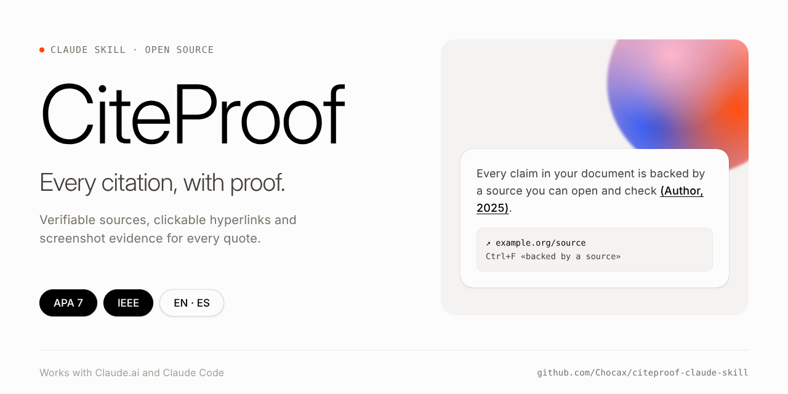
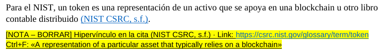
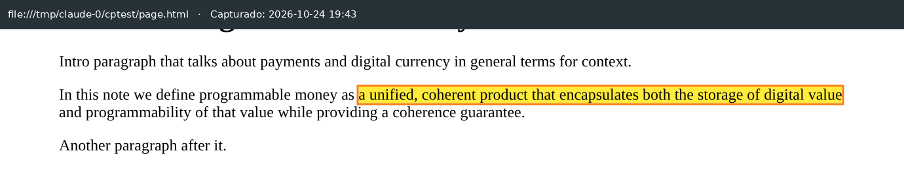
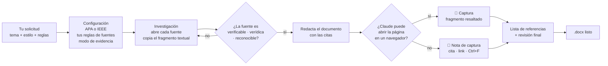

<div align="center">



# 📎 CiteProof

**Cada cita, con su prueba.**
Una skill para Claude que escribe documentos académicos en **APA 7** o **IEEE** donde cada cita trae una evidencia que puedes verificar: una captura automática del fragmento exacto, o una nota con link clicable y el texto textual para buscar con Ctrl+F.

[](README.es.md)
[](README.md)


</div>

---

## Contenido

- [¿Por qué CiteProof?](#por-qué-citeproof)
- [Cómo se ve](#cómo-se-ve)
- [Cómo funciona](#cómo-funciona)
- [Instalación](#instalación)
- [Uso](#uso)
- [Tus reglas de fuentes](#tus-reglas-de-fuentes)
- [Modos de evidencia](#modos-de-evidencia)
- [Preguntas frecuentes](#preguntas-frecuentes)
- [Estructura del repositorio](#estructura-del-repositorio)
- [Contribuir](#contribuir)

---

## ¿Por qué CiteProof?

Una cita vale lo que puedas demostrar que la fuente de verdad lo dice. Encontrar una fuente sólida para cada afirmación, darle el formato correcto y guardar la prueba del fragmento exacto toma horas a mano, y pedírselo a una IA da referencias inventadas o un formato distinto cada vez.

CiteProof vuelve ese proceso repetible:

| | Sin CiteProof | Con CiteProof |
|---|---|---|
| Fuentes | Lo que el modelo recuerde | Solo fuentes que Claude abrió y que cumplen tus reglas |
| Citas textuales | Parafraseadas de memoria | Fragmento copiado tal cual de la página |
| Prueba | Te toca buscar cada fragmento | Captura insertada, o nota con link y texto para Ctrl+F |
| Links | Texto plano sin clic | Hipervínculos reales (Ctrl+clic funciona) |
| Formato | Cambia cada vez | Siempre la misma nota y el mismo estilo de referencias |
| Honestidad | Se cuelan afirmaciones sin respaldo | Lo que no se pudo abrir queda marcado como **UNVERIFIED** (no verificado) |

## Cómo se ve

**Modo manual:** una nota resaltada debajo del párrafo. Dice en qué cita va el hipervínculo, trae el link clicable y el texto exacto que hay que buscar.



**Modo automático:** Claude abre la página, resalta el fragmento e inserta la captura con la URL y la fecha estampadas arriba. La captura queda enlazada a la página.


<sub>Demo tomada de una página de prueba local.</sub>

## Cómo funciona



## Instalación

Elige dónde usas Claude y haz clic para desplegar.

<details>
<summary><b>🌐 Claude.ai (web, app de escritorio o celular)</b></summary>

<br>

1. Verifica que la **ejecución de código** esté activa: **Configuración → Capacidades → Ejecución de código y creación de archivos** (en planes Team/Enterprise un administrador habilita las Skills).
2. Descarga **[`dist/citeproof.zip`](dist/citeproof.zip)** de este repositorio (o del último Release).
3. Ve a **Personalizar → Skills**, haz clic en **+** y luego en **+ Crear skill → Subir una skill**.
4. Sube `citeproof.zip` y **activa** la skill.
5. Abre un chat y pide un documento con citas. Claude usará CiteProof automáticamente.

> Guía oficial: [Usar Skills en Claude](https://support.claude.com/en/articles/12512180-use-skills-in-claude)

</details>

<details>
<summary><b>💻 Claude Code: instalar como plugin (recomendado)</b></summary>

<br>

Dentro de Claude Code:

```text
/plugin marketplace add Chocax/citeproof-claude-skill
/plugin install citeproof@citeproof
```

O desde la terminal:

```bash
claude plugin marketplace add Chocax/citeproof-claude-skill
claude plugin install citeproof@citeproof
```

Las actualizaciones llegan cuando actualizas el marketplace (`/plugin` → Marketplaces).

> Guía oficial: [Plugin marketplaces](https://code.claude.com/docs/en/plugin-marketplaces)

</details>

<details>
<summary><b>💻 Claude Code: instalación manual (copiar la carpeta)</b></summary>

<br>

```bash
git clone https://github.com/Chocax/citeproof-claude-skill.git
mkdir -p ~/.claude/skills
cp -r citeproof-claude-skill/plugins/citeproof/skills/citeproof ~/.claude/skills/
```

Reinicia Claude Code. La skill queda en `~/.claude/skills/citeproof/`.

</details>

<details>
<summary><b>📸 Opcional: activar las capturas automáticas</b></summary>

<br>

El modo automático necesita Python con Playwright y Chromium en la máquina donde corre Claude:

```bash
pip install playwright pillow
python -m playwright install chromium
```

Para generar `.docx` también se usa el paquete `docx` de Node (`npm install docx`). Claude instala lo que falte cuando puede.

En Claude.ai el entorno muchas veces no puede entrar a sitios externos, así que CiteProof pasa solo a las notas de captura. En Claude Code, en tu propio computador, el modo automático suele funcionar.

</details>

## Uso

Solo pídelo, no hace falta nombrar la skill:

> *"Hazme un documento en Word sobre energías renovables con citas APA y notas para sacar las capturas. Mínimo cinco artículos científicos."*

> *"Escribe el estado del arte de mi paper en formato IEEE. Toma tú las capturas y déjame la nota cuando no puedas."*

> *"Te adjunto mi ensayo. Ponle una fuente verificable y su evidencia a cada afirmación."*

Más ejemplos en **[examples/prompts.md](examples/prompts.md)**.

**Cuando recibas el documento (modo manual):**

1. Ctrl+clic en el link de la nota amarilla.
2. Ctrl+F y pega el fragmento de la nota.
3. Toma la captura del fragmento resaltado y pégala donde está la nota.
4. Ponle el hipervínculo a la cita que dice la nota, por ejemplo `(Lee, 2021)` o `[3]`.
5. Borra la nota.

## Tus reglas de fuentes

CiteProof **siempre** aplica una base: toda fuente debe ser **verificable** (Claude la abrió y tú también puedes), **verídica** (el texto citado de verdad está ahí) y **reconocible** (un autor o editor creíble).

Encima de eso, **tú** pones las reglas de cada documento. Escríbelas en tu solicitud o guárdalas una vez en las instrucciones de tu proyecto o en tus preferencias:

```text
Reglas CiteProof:
- Estilo: APA 7, en español
- Solo fuentes de los últimos 5 años
- Definiciones de organismos oficiales de normalización
- Incluir mínimo 5 artículos científicos
- Nada de blogs ni foros
- Evidencia: notas manuales
```

Si alguna regla no se puede cumplir (por ejemplo, no hay estudios científicos sobre un tema muy nuevo), CiteProof lo dice en vez de inventarlo.

## Modos de evidencia

| Modo | Qué recibes | Ideal para |
|---|---|---|
| `auto` | Captura enlazada con el fragmento resaltado, URL y fecha | Claude Code en tu computador |
| `manual` | Nota amarilla: cita · link clicable · fragmento para Ctrl+F | Claude.ai, páginas con muro de pago o login, PDFs |
| `both` | Captura cuando se puede y nota cuando no *(comportamiento por defecto)* | Todo |

## Preguntas frecuentes

<details>
<summary><b>¿Se inventa fuentes?</b></summary>

No. Solo cita páginas que abrió durante la sesión y copia el fragmento citado desde la página. Si algo no se pudo abrir pero tiene que quedarse, queda marcado como <b>UNVERIFIED</b> (no verificado) y aparece en el mensaje final de Claude.
</details>

<details>
<summary><b>¿Funciona en otros idiomas?</b></summary>

Sí. Las notas y los pies de figura van en el idioma del documento. Los fragmentos citados se dejan en el idioma original de la fuente, porque eso es lo que encuentra Ctrl+F.
</details>

<details>
<summary><b>¿Puede entregar algo distinto a Word?</b></summary>

Sí: Google Docs, Markdown o PDF. Los helpers de `.docx` son una ayuda, y las reglas (cita indicada, link clicable, fragmento textual) aplican en cualquier formato.
</details>

<details>
<summary><b>¿Por qué los links de mis documentos anteriores no se podían abrir?</b></summary>

Porque estaban escritos como texto plano. CiteProof escribe cada URL como un hipervínculo real, así que Ctrl+clic la abre.
</details>

<details>
<summary><b>¿Puedo usarlo para estudio o trabajo?</b></summary>

CiteProof te ayuda a encontrar, citar y demostrar fuentes. Revisa la política de tu institución o empresa sobre escritura asistida por IA y lee siempre las fuentes que citas.
</details>

## Estructura del repositorio

```text
citeproof-claude-skill/
├── .claude-plugin/marketplace.json      # permite instalar el repo en Claude Code
├── plugins/citeproof/
│   ├── .claude-plugin/plugin.json
│   └── skills/citeproof/                # ← la skill
│       ├── SKILL.md                     # instrucciones que sigue Claude
│       ├── references/
│       │   ├── apa7.md                  # formatos APA 7 por tipo de fuente
│       │   ├── ieee.md                  # formatos IEEE por tipo de fuente
│       │   └── source-policy.md         # niveles de fuentes y cómo reemplazar las débiles
│       └── scripts/
│           ├── capture.py               # capturas automáticas (Playwright)
│           └── docx_notes.js            # notas en Word con hipervínculos reales
├── dist/citeproof.zip                   # listo para subir a Claude.ai
├── docs/assets/                         # imágenes del README
└── examples/prompts.md
```

## Contribuir

Se reciben issues y pull requests: nuevos estilos (Chicago, Vancouver), mejores capturas de PDFs, más idiomas.
Después de editar la skill, regenera el zip para Claude.ai:

```bash
cd plugins/citeproof/skills && zip -r ../../../dist/citeproof.zip citeproof -x "*/__pycache__/*"
```

## Licencia

[MIT](LICENSE) © 2026 Santiago Pinzón Vásquez ([@Chocax](https://github.com/Chocax))
