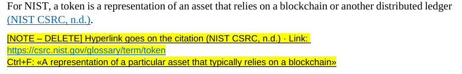
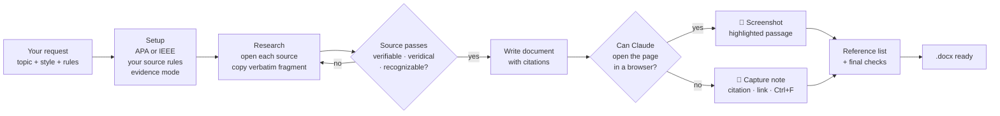

<div align="center">

# 📎 CiteProof

**Every citation, with proof.**
A skill for Claude that writes academic documents in **APA 7** or **IEEE** where every citation comes with evidence you can check: an automatic screenshot of the exact passage, or a capture note with a clickable link and the verbatim text to find with Ctrl+F.

[](README.es.md)
[](README.md)


</div>

---

## Contents

- [Why CiteProof?](#why-citeproof)
- [What it looks like](#what-it-looks-like)
- [How it works](#how-it-works)
- [Install](#install)
- [Use it](#use-it)
- [Your source rules](#your-source-rules)
- [Evidence modes](#evidence-modes)
- [FAQ](#faq)
- [Repository layout](#repository-layout)
- [Contributing](#contributing)

---

## Why CiteProof?

A citation is only as good as your ability to show that the source really says it. Finding a solid source for every claim, formatting it correctly and keeping proof of the exact passage takes hours when done by hand, and asking an AI for it gives invented references or a different format every time.

CiteProof makes that workflow repeatable:

| | Without CiteProof | With CiteProof |
|---|---|---|
| Sources | Whatever the model remembers | Only sources Claude actually opened, checked against your rules |
| Quotes | Paraphrased from memory | Verbatim fragment copied from the page |
| Proof | You hunt for each passage | Screenshot inserted, or a note with link + Ctrl+F text |
| Links | Plain text you can't click | Real hyperlinks (Ctrl+click works) |
| Format | Changes every time | Same note format, same reference style |
| Honesty | Unverifiable claims slip through | Sources that couldn't be opened are marked **UNVERIFIED** |

## What it looks like

**Manual mode:** a highlighted note after the paragraph. It names the citation that gets the hyperlink, gives a clickable link and the exact text to search.



**Auto mode:** Claude opens the page, highlights the passage and inserts the screenshot with the URL and capture date stamped on top. The screenshot is linked to the page.


<sub>Demo captured from a local test page.</sub>

## How it works



## Install

Pick where you use Claude. Click to expand.

<details>
<summary><b>🌐 Claude.ai (web, desktop or mobile app)</b></summary>

<br>

1. Make sure **code execution** is on: **Settings → Capabilities → Code execution and file creation** (on Team/Enterprise plans an admin enables Skills).
2. Download **[`dist/citeproof.zip`](dist/citeproof.zip)** from this repository (or from the latest Release).
3. Go to **Customize → Skills**, click **+**, then **+ Create skill → Upload a skill**.
4. Upload `citeproof.zip` and switch the skill **on**.
5. Start a chat and ask for a document with citations. Claude will use CiteProof automatically.

> Official guide: [Use Skills in Claude](https://support.claude.com/en/articles/12512180-use-skills-in-claude)

</details>

<details>
<summary><b>💻 Claude Code: install as a plugin (recommended)</b></summary>

<br>

Inside Claude Code:

```text
/plugin marketplace add Chocax/citeproof-claude-skill
/plugin install citeproof@citeproof
```

Or from your terminal:

```bash
claude plugin marketplace add Chocax/citeproof-claude-skill
claude plugin install citeproof@citeproof
```

Updates arrive when you update the marketplace (`/plugin` → Marketplaces).

> Official guide: [Plugin marketplaces](https://code.claude.com/docs/en/plugin-marketplaces)

</details>

<details>
<summary><b>💻 Claude Code: manual install (copy the folder)</b></summary>

<br>

```bash
git clone https://github.com/Chocax/citeproof-claude-skill.git
mkdir -p ~/.claude/skills
cp -r citeproof-claude-skill/plugins/citeproof/skills/citeproof ~/.claude/skills/
```

Restart Claude Code. The skill lives in `~/.claude/skills/citeproof/`.

</details>

<details>
<summary><b>📸 Optional: enable automatic screenshots</b></summary>

<br>

Auto mode needs Python with Playwright and Chromium on the machine where Claude runs:

```bash
pip install playwright pillow
python -m playwright install chromium
```

For `.docx` output, Node's `docx` package is also used (`npm install docx`). Claude installs what's missing when it can.

On Claude.ai the sandbox often can't reach external websites, so CiteProof falls back to capture notes automatically. In Claude Code on your own computer, auto mode usually works.

</details>

## Use it

Just ask. You don't need to name the skill:

> *"Write a Word report on carbon capture with APA citations and a capture note for every source. At least five peer-reviewed articles."*

> *"Draft my related-work section in IEEE style. Take the screenshots yourself and leave a note when you can't."*

> *"Here is my essay. Add a verifiable source and evidence to every claim."*

More in **[examples/prompts.md](examples/prompts.md)**.

**After you get the document (manual mode):**

1. Ctrl+click the link in the yellow note.
2. Ctrl+F and paste the fragment from the note.
3. Screenshot the highlighted passage and paste it where the note is.
4. Hyperlink the citation the note names, e.g. `(Lee, 2021)` or `[3]`.
5. Delete the note.

## Your source rules

CiteProof **always** applies a baseline: every source must be **verifiable** (Claude opened it and you can too), **veridical** (the quoted text is really there) and **recognizable** (a credible author or publisher).

On top of that, **you** set the rules for each document. Write them in your request, or save them once in your project or custom instructions:

```text
CiteProof rules:
- Style: APA 7, in Spanish
- Only sources from the last 5 years
- Definitions from official standards bodies
- Include at least 5 peer-reviewed articles
- No blogs or forums
- Evidence: manual notes
```

If a rule can't be met (for example, there are no peer-reviewed studies on a very new topic), CiteProof says so instead of inventing one.

## Evidence modes

| Mode | What you get | Best for |
|---|---|---|
| `auto` | Hyperlinked screenshot with highlighted passage, URL and date | Claude Code on your computer |
| `manual` | Yellow note: citation · clickable link · Ctrl+F fragment | Claude.ai, paywalled or login-only pages, PDFs |
| `both` | Screenshot where possible, note where not *(default behavior)* | Everything |

## FAQ

<details>
<summary><b>Will it invent sources?</b></summary>

No. It only cites pages it opened during the session and copies the quoted fragment from the page. If something can't be opened but has to stay, it's marked <b>UNVERIFIED</b> and listed in Claude's final message.
</details>

<details>
<summary><b>Does it work in other languages?</b></summary>

Yes. Notes and captions follow the document's language. Quoted fragments stay in the source's original language, because that's what Ctrl+F will find.
</details>

<details>
<summary><b>Can it output something other than Word?</b></summary>

Yes: Google Docs, Markdown or PDF. The `.docx` helpers are a convenience, and the rules (named citation, clickable link, verbatim fragment) apply to any format.
</details>

<details>
<summary><b>Why are the links in my old documents not clickable?</b></summary>

Because they were written as plain text. CiteProof writes every URL as a real hyperlink element, so Ctrl+click opens it.
</details>

<details>
<summary><b>Can I use it for school or work?</b></summary>

CiteProof helps you find, cite and prove sources. Check your organization's policy on AI-assisted writing, and always read the sources you cite.
</details>

## Repository layout

```text
citeproof-claude-skill/
├── .claude-plugin/marketplace.json      # makes the repo installable in Claude Code
├── plugins/citeproof/
│   ├── .claude-plugin/plugin.json
│   └── skills/citeproof/                # ← the skill itself
│       ├── SKILL.md                     # instructions Claude follows
│       ├── references/
│       │   ├── apa7.md                  # APA 7 formats by source type
│       │   ├── ieee.md                  # IEEE formats by source type
│       │   └── source-policy.md         # source tiers and how to replace weak ones
│       └── scripts/
│           ├── capture.py               # auto screenshots (Playwright)
│           └── docx_notes.js            # Word notes with real hyperlinks
├── dist/citeproof.zip                   # ready to upload to Claude.ai
├── docs/assets/                         # README images
└── examples/prompts.md
```

## Contributing

Issues and pull requests are welcome: new citation styles (Chicago, Vancouver), better capture for PDFs, more languages.
After editing the skill, rebuild the Claude.ai zip:

```bash
cd plugins/citeproof/skills && zip -r ../../../dist/citeproof.zip citeproof -x "*/__pycache__/*"
```

## License

[MIT](LICENSE) © 2026 Santiago Pinzón Vásquez ([@Chocax](https://github.com/Chocax))
